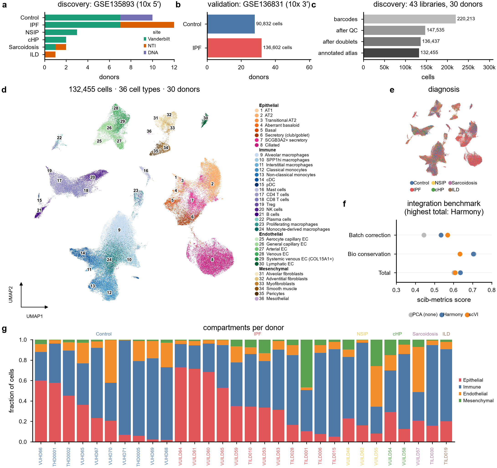

# Alveolar epithelial remodelling in idiopathic pulmonary fibrosis — a single-cell atlas with independent replication

A complete single-cell RNA-seq analysis of idiopathic pulmonary fibrosis (IPF) lungs,
from public count matrices and raw reads to publication figures. A discovery atlas
of 132,455 cells from 30 donors (GSE135893) is annotated, tested for changes in
cell-type composition, gene expression, pathway activity, epithelial fate and
cell–cell communication, and the main findings are re-tested in an independent cohort
of 60 donors and 227,434 cells (GSE136831) processed with different chemistry.



## Findings

**The atlas.** Quality control was calibrated per library and checked against the
published cell types before each threshold was adopted, which kept secretory and
plasma cells that a generic top-gene filter would have removed. Harmony integration
scored best in a scib-metrics benchmark (0.636 vs 0.608 for scVI). A three-level,
rule-based annotation with recorded evidence for every subcluster resolved 36 cell
types, including transitional AT2, aberrant basaloid (KRT17⁺KRT5⁻) and SPP1<sup>hi</sup>
macrophage states ([Figure 1](docs/figures.md#figure-1--cohorts-quality-control-and-the-discovery-atlas)).

**Composition.** Basal cells, SCGB3A2⁺ secretory cells, systemic venous (COL15A1⁺)
endothelium, conventional dendritic cells and SPP1<sup>hi</sup> macrophages increased in
IPF in both propeller and scCODA. Aberrant basaloid cells were about six times more
frequent (propeller FDR 0.012) but not credible in scCODA, and AT1/AT2 cells fell.
Results held in the only site that contributed both groups (Spearman ρ = 0.84)
([Figure 2](docs/figures.md#figure-2--cell-type-composition-in-ipf)).

**Expression and pathways.** Pseudobulk edgeR found 3,164 DEGs in 31 cell types,
concentrated in airway secretory cells, AT2 cells and monocyte-derived macrophages,
with near-identical fold changes in DESeq2 (median r = 0.99). Every DEG kept its sign
after adjustment for site and in the balanced site alone, and a median 99 % kept
P < 0.05. *MMP7*, *CCND1*, *GPX3* and *CRIP1* changed in seven cell types each. EGFR,
NF-κB, MAPK, PI3K and TNF-α footprints were the most widespread PROGENy changes
([Figure 3](docs/figures.md#figure-3--differential-expression-pathways-and-transcription-factors)).

**Epithelial fate.** CellRank placed transitional AT2 cells on the path to the aberrant
basaloid state (fate probability 0.26 vs 0.07 for AT2 cells). The bias did not differ
between control and IPF donors (P = 0.91, 4 vs 6 donors): the route is present in both,
and IPF lungs hold more cells at its end point. *MDK*, *SOX4*, *KRT17*, *MMP7* and
*COL1A1* are the genes most correlated with the fate ([Figure 4](docs/figures.md#figure-4--the-alveolar-epithelial-trajectory-to-aberrant-basaloid-cells)).

**Communication.** 602 ligand–receptor pairs had both partners up in IPF, and only
8 had both down. The strongest profibrotic axes were SPP1–CD44 from macrophages to
airway secretory cells and TGFB1–ITGB8 from AT2 to transitional AT2 cells, the
integrin that activates latent TGF-β
([Figure 5](docs/figures.md#figure-5--cellcell-communication)).

**Replication.** A classifier trained on the discovery labels annotated the
validation cohort with a balanced accuracy of 0.84 against the authors' own labels and
recovered 91 % of their aberrant basaloid cells; the 50-gene basaloid signature found
those cells with an AUROC of 0.992. All 12 within-compartment composition changes kept
their direction and 10 were significant again, including the expansion of aberrant
basaloid, basal, systemic venous and SPP1<sup>hi</sup> macrophage populations and the
loss of AT1 and AT2 cells. Discovery DEGs kept their sign more often than chance in all
15 testable cell types (median 79 %), and TGF-β pathway activity replicated (ρ = 0.54).
The strongest discovery pathway signals, NF-κB, TNF-α and MAPK, did not replicate and
persisted after adjustment for site; they are reported as an acute inflammatory programme
specific to the discovery cohort rather than as IPF biology
([Figure 6](docs/figures.md#figure-6--replication-in-an-independent-cohort)).

**From raw reads.** Eight discovery libraries were re-processed from FASTQ on Linux.
STARsolo reproduced the published Cell Ranger matrix (barcode Jaccard 0.94–0.99,
≥ 99.5 % of annotated cells recovered, per-cell UMI r ≥ 0.999), so the analysis does
not depend on the aligner. CellBender removed at most 5 % of the median cell's counts
in every cell type but plasma cells; it kept all *KRT17*, *MMP7*, *KRT8* and *CLDN4*
counts of aberrant basaloid and transitional AT2 cells while removing about 90 % of
the *SFTPC* and *SCGB1A1* counts found in macrophages, so the two epithelial states are
not ambient artefacts. RNA velocity, limited by the few unspliced reads of 5′ data,
ran from AT2 towards the aberrant basaloid and basal states (Notebook 14). pySCENIC
found 310 robust regulons; SOX4, ELK3 and STAT1 activity rose with the aberrant
basaloid fate, and ETS1, KLF4, KLF7, ATF3 and STAT1 were more active in aberrant
basaloid cells by both SCENIC and CollecTRI (Notebook 15).

## Data

| cohort | GEO | donors | chemistry | role |
|---|---|---|---|---|
| Habermann *et al.* 2020, *Sci Adv* | [GSE135893](https://www.ncbi.nlm.nih.gov/geo/query/acc.cgi?acc=GSE135893) | 10 control, 12 IPF, 8 other ILD (3 sites) | 10x 5′ v1 | discovery |
| Adams *et al.* 2020, *Sci Adv* | [GSE136831](https://www.ncbi.nlm.nih.gov/geo/query/acc.cgi?acc=GSE136831) | 28 control, 32 IPF | 10x 3′ v2 | validation |

FASTQ files of eight discovery libraries (4 control, 4 IPF) are re-aligned on Linux
for the upstream analyses. Downloads are scripted, resumable and checksummed; see
[docs/data_provenance.md](docs/data_provenance.md). Site and diagnosis are partly
confounded in the discovery cohort (one site gave only controls, another only
disease samples), which is why every discovery result is also tested within the one
balanced site and in the validation cohort.

## Analysis

| notebook | step | main methods |
|---|---|---|
| [01](notebooks/01_data_acquisition.ipynb) | data acquisition | GEO download with SHA-256 manifest; donor sex from *XIST*/chrY |
| [02](notebooks/02_quality_control.ipynb) | quality control | per-library MAD thresholds; scDblFinder and Scrublet |
| [03](notebooks/03_normalization_features.ipynb) | normalisation | shifted log, Pearson residuals; batch-aware HVGs |
| [04](notebooks/04_integration.ipynb) | integration | Harmony vs scVI, scib-metrics benchmark |
| [05](notebooks/05_clustering_annotation.ipynb) | annotation | three-level Leiden; marker rules, CellTypist (HLCA) as tie-breaker |
| [06](notebooks/06_compositional_analysis.ipynb) | composition | propeller, scCODA, Milo; site sensitivity |
| [07](notebooks/07_pseudobulk_de.ipynb) | differential expression | pseudobulk edgeR-QL and DESeq2; site sensitivity |
| [08](notebooks/08_pathways_tf_activity.ipynb) | pathways and TFs | decoupler: PROGENy, CollecTRI, Hallmark |
| [09](notebooks/09_epithelial_trajectory.ipynb) | epithelial trajectory | PAGA, diffusion pseudotime, CellRank 2; basaloid signature |
| [10](notebooks/10_cell_communication.ipynb) | communication | LIANA+ consensus; pseudobulk differential interactions |
| [11](notebooks/11_validation_preprocessing.ipynb) | validation preprocessing | same QC; scVI |
| [12](notebooks/12_validation_replication.ipynb) | replication | CellTypist label transfer; signature ROC; composition, DE, pathways |
| [13](notebooks/13_main_figures.ipynb) | main figures | figures 1–6 from the result tables |
| [14](notebooks/14_upstream_reprocessing.ipynb) | upstream re-processing (Linux) | STARsolo vs Cell Ranger; CellBender ambient RNA; scVelo |
| [15](notebooks/15_scenic_regulons.ipynb) | gene-regulatory networks (Linux) | pySCENIC regulons along the alveolar lineage |

Methods are written up in [docs/methods.md](docs/methods.md) with references in
[docs/references.md](docs/references.md). Figure legends are in
[docs/figures.md](docs/figures.md).

Some decisions are worth reading because the defaults would have given different answers:

* **QC thresholds were checked against cell identity.** A filter on the fraction of
  counts in the top 20 genes is common, but here it removed plasma, goblet, club and
  AT2 cells, so it was reported and not applied (Notebook 02).
* **Compartment calls use detection fractions, not `score_genes`.** Control-gene
  subtraction gave RNA-rich alveolar macrophages negative immune scores (Notebook 05).
* **Harmony runs single-threaded on the CPU.** Multithreaded or CUDA runs differed
  in the third decimal, enough to move the Leiden boundaries of rare states (Notebook 05).
* **The CytoTRACE kernel was rejected.** It ranked aberrant basaloid cells as the most
  potent cells and absorbed every population into them; the trajectory is instead
  rooted in AT2 cells, the established alveolar progenitor (Notebook 09).
* **Label transfer uses fine over-clustering.** Majority voting over coarse clusters
  let abundant types outvote rare ones, and aberrant basaloid cells disappeared from
  the transferred labels (Notebook 12).

## Running it

Windows 11 with an NVIDIA GPU (scVI) and R 4.x for the Bioconductor steps; the
analysis also runs on Linux. Peak memory is about 40 GB and a full run takes about
three hours. Details are in [docs/pipeline.md](docs/pipeline.md).

```powershell
powershell -ExecutionPolicy Bypass -File envs\setup_windows.ps1   # conda env, CUDA PyTorch, Jupyter kernel
Rscript envs\r_packages.R                                          # Bioconductor packages
powershell -ExecutionPolicy Bypass -File run_pipeline.ps1 -SkipSetup
```

Single notebooks: `python workflow\scripts\run_notebooks.py 07` (or `--from 07`).
Every threshold lives in [config/config.yaml](config/config.yaml). Unit tests:
`python -m pytest -q tests`.

The Linux-only steps (STARsolo, CellBender, pySCENIC) are a self-contained package
in [linux_upstream/](linux_upstream/README.md); Notebooks 14–15 run once its results
are copied back.

## Repository layout

```
config/            parameters, marker genes, dataset URLs
src/ipfatlas/      Python package used by the notebooks (QC, annotation, pseudobulk, plotting …)
workflow/          R scripts (scDblFinder, edgeR/DESeq2, propeller) and runners
notebooks/py/      notebook sources (Jupytext); notebooks/*.ipynb are the executed copies
results/figures/   every figure as SVG and 300-dpi PNG/JPG (main figures in 13_main/)
results/tables/    every result table as CSV/XLSX (large tables as .csv.gz)
linux_upstream/    FASTQ → counts, ambient RNA and regulons on Linux
docs/              methods, figure legends, pipeline, data provenance, references
tests/             unit tests for the package
```

Raw data and intermediate `.h5ad` files are not in the repository; the pipeline
re-creates them.

## Limitations

* The discovery cohort has 10 control and 12 IPF donors, and site is partly
  confounded with diagnosis. Site sensitivity analyses and the validation cohort
  address this, but small effects in rare cell types remain uncertain.
* Composition is measured on dissociated cells, whose recovery differs between cell
  types and between fibrotic and normal tissue; ratios within a compartment reduce but
  do not remove this bias.
* Trajectory direction comes from the pseudotime root (AT2 cells), not from the data
  alone; RNA velocity in Notebook 14 agrees, but 5′ libraries have few unspliced reads
  (8.9 %), so it is an exploratory check.
* The checks from raw reads (STARsolo, CellBender, velocity) cover 8 of the discovery
  libraries, and SCENIC regulons agree only modestly with curated CollecTRI targets
  (ρ = 0.21).
* Ligand–receptor analyses infer potential, not actual, signalling.

## License and data

Code is under the [MIT License](LICENSE). The data belong to their authors; cite
Habermann *et al.*, *Sci Adv* 2020;6:eaba1972 and Adams *et al.*, *Sci Adv*
2020;6:eaba1983 when using them.
