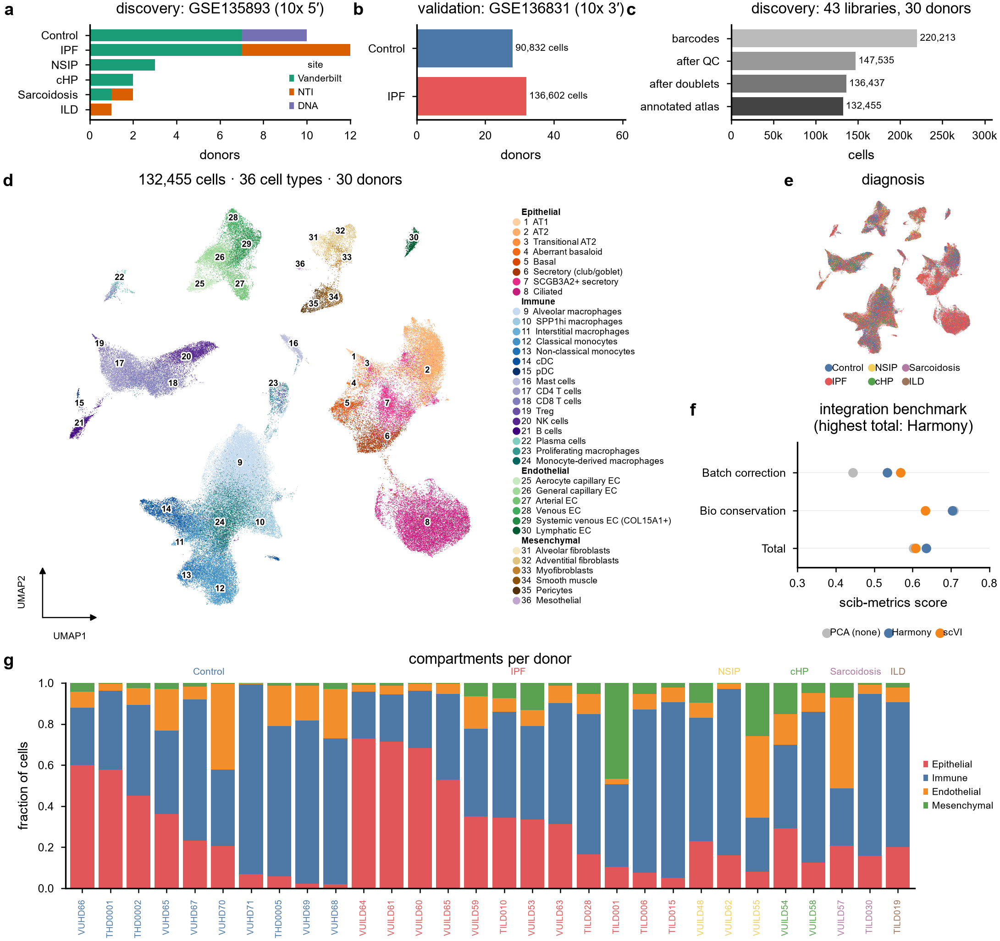
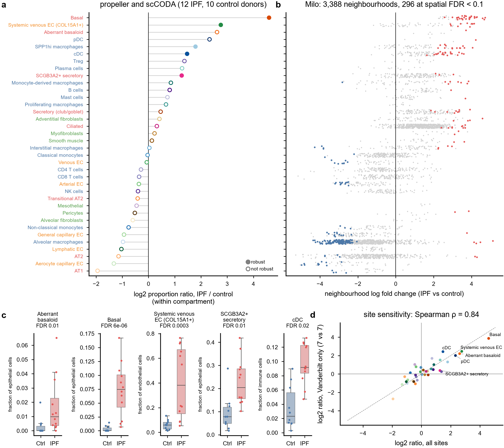
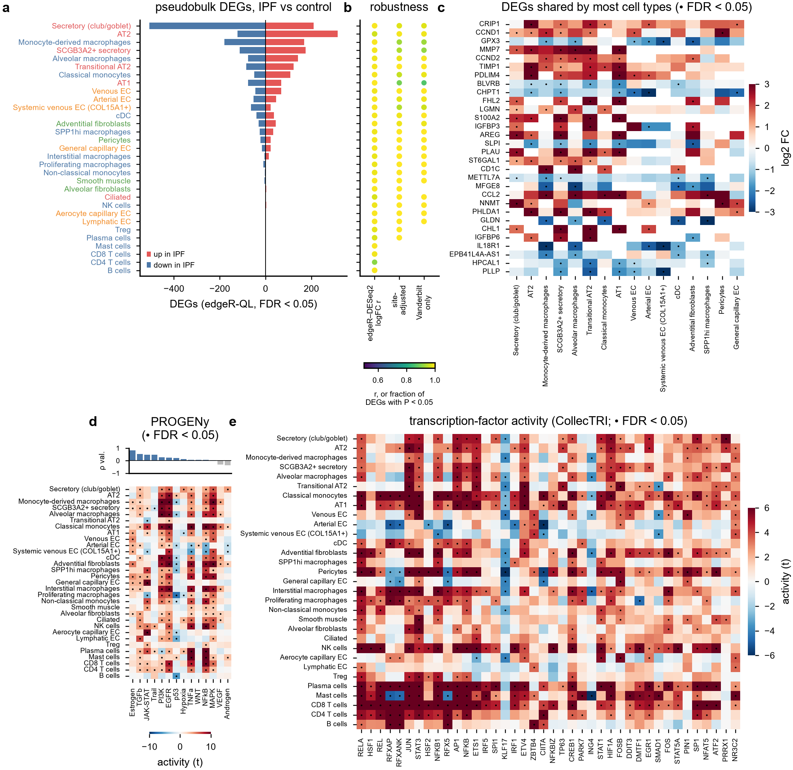
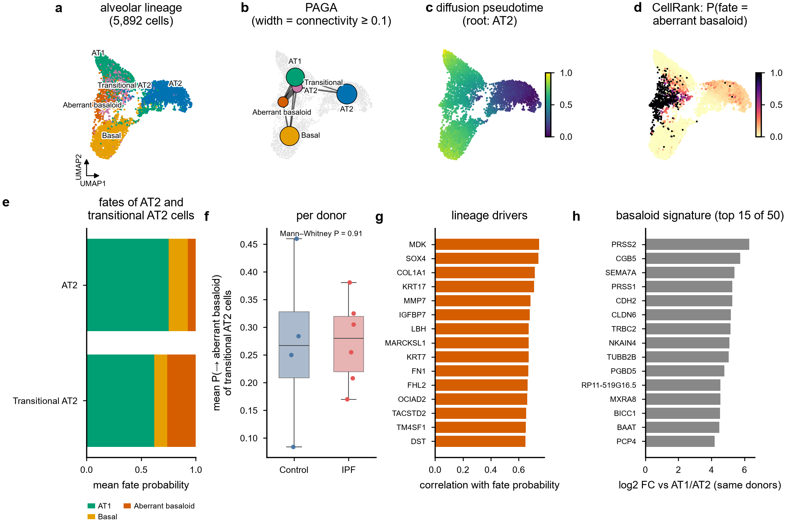
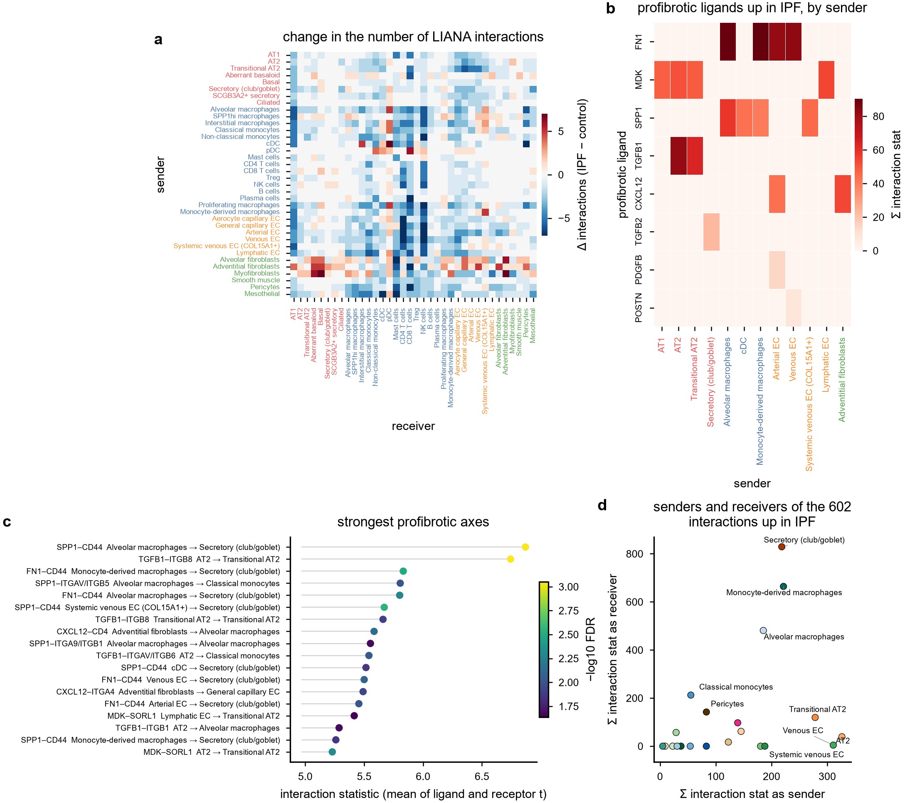
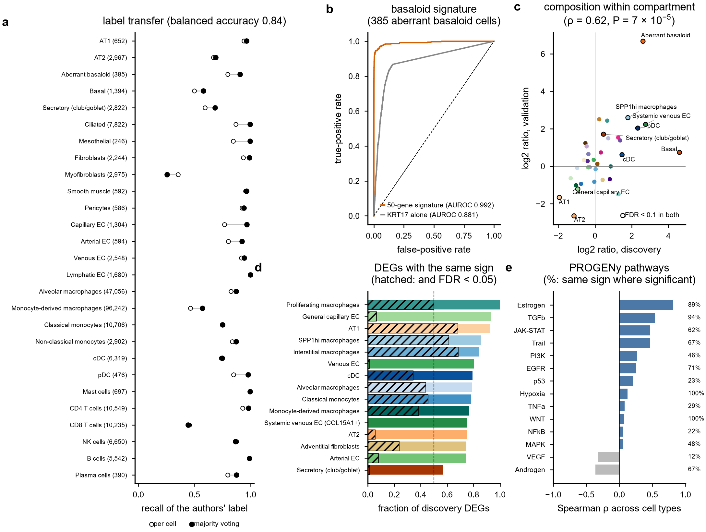

# Figures

The six main figures are assembled by Notebook 13 from the result tables of
Notebooks 01–12 and saved in `results/figures/13_main/` as SVG, PNG and JPG
(300 dpi, 183 mm wide). Each analysis notebook also saves its own figures in
`results/figures/<notebook>/`; those are indexed at the end. Numbers in the legends
are those written to `results/tables/`.

Abbreviations: AT1/AT2, alveolar type 1/2 cells; DEG, differentially expressed gene;
EC, endothelial cells; FDR, Benjamini–Hochberg false discovery rate; ILD,
interstitial lung disease; IPF, idiopathic pulmonary fibrosis.

## Figure 1 · Cohorts, quality control and the discovery atlas

**a**, Discovery cohort (GSE135893; 10x Genomics 5′ v1): donors per diagnosis,
coloured by site. Only Vanderbilt contributed both controls and IPF (7 and 7); DNA
contributed 3 controls and NTI only fibrotic ILD. **b**, Validation cohort (GSE136831;
10x 3′ v2): 28 control and 32 IPF donors with 90,832 and 136,602 cells after quality
control. **c**, Discovery cells through the pipeline: 220,213 barcodes, 147,535 after
per-library MAD and hard thresholds, 136,437 after removal of scDblFinder doublets and
132,455 in the annotated atlas (subclusters that were unresolved, expressed markers of
two lineages or had < 50 cells were removed). **d**, UMAP of the Harmony-integrated
atlas with 36 cell types, numbered by compartment (key). **e**, The same UMAP coloured
by diagnosis. **f**, Integration benchmark (scib-metrics, 40,000-cell stratified
subsample): Harmony had the highest total score (0.636; scVI 0.608, unintegrated PCA
0.602). **g**, Fraction of each donor's cells in the four compartments, donors grouped
by diagnosis.

## Figure 2 · Cell-type composition in IPF

**a**, log2 ratio of the mean cell-type proportion in IPF (12 donors) and controls
(10 donors), computed within each compartment. Filled markers are robust changes:
propeller FDR < 0.05 within the compartment and a credible effect in scCODA. Five
populations increased robustly: basal cells (log2 ratio 4.6), systemic venous EC
(COL15A1⁺), SCGB3A2⁺ secretory cells, conventional dendritic cells and
SPP1hi macrophages. Aberrant basaloid cells increased about six-fold (log2 ratio 2.6,
propeller FDR 0.012) but were not credible in scCODA; AT1 and AT2 cells decreased
(FDR 0.012 and 0.021) with the same caveat. Labels are coloured by compartment.
**b**, Milo differential abundance on the integrated k-nearest-neighbour graph,
without cluster boundaries: 3,388 neighbourhoods in which ≥ 60 % of cells share one
cell type, in the rows of **a**; 296 had spatial FDR < 0.1 (coloured by direction).
**c**, Per-donor proportions within the compartment for aberrant basaloid cells and
the four most significant robust changes; propeller FDR within the compartment.
**d**, Site sensitivity: log2 ratios using all donors against those from the
Vanderbilt donors only (7 vs 7), Spearman ρ = 0.84 over 36 cell types.

## Figure 3 · Differential expression, pathways and transcription factors

**a**, DEGs per cell type in pseudobulk edgeR quasi-likelihood tests of IPF against
control (`~ sex + diagnosis`, FDR < 0.05): 3,164 DEGs across 31 tested cell types
(1,632 up in IPF), most in secretory (club/goblet) cells (717), AT2 cells (436) and
monocyte-derived macrophages (348). **b**, Robustness of each cell type's result:
Pearson correlation of log2 fold changes between edgeR and DESeq2, and the fraction of
DEGs with the same sign and P < 0.05 after adding site as a covariate or in the
Vanderbilt donors alone. **c**, The 30 genes that are DEGs in the most cell types
(*CRIP1*, *CCND1*, *GPX3* and *MMP7* in seven each) in cell types with ≥ 30 DEGs;
dots mark FDR < 0.05. **d**, PROGENy pathway activities (decoupler univariate linear
model on the edgeR statistics). Pathways are ordered by their replication in the
validation cohort (top bars: Spearman ρ of activities across cell types; Figure 6e);
dots mark FDR < 0.05. **e**, CollecTRI transcription-factor activities for the 40
factors with the largest significant activity among the 125 that are significant
(FDR < 0.05) in at least six cell types.

## Figure 4 · The alveolar epithelial trajectory to aberrant basaloid cells

**a**, UMAP of 5,892 alveolar lineage cells (AT2, transitional AT2, AT1, aberrant
basaloid and basal cells, at most 1,800 per type). **b**, PAGA connectivity between
the cell types (edges ≥ 0.1; node area proportional to the number of cells).
**c**, Diffusion pseudotime rooted in AT2 cells. **d**, CellRank probability of reaching
the aberrant basaloid state (pseudotime kernel 0.8, connectivity kernel 0.2; AT1,
aberrant basaloid and basal cells as absorbing states). **e**, Mean fate probabilities:
transitional AT2 cells were more likely than AT2 cells to reach the aberrant basaloid
state (0.26 vs 0.07). **f**, Mean aberrant basaloid fate probability of the transitional
AT2 cells of each donor with ≥ 10 such cells (4 controls, 6 IPF); the fate is not
specific to IPF lungs (two-sided Mann–Whitney P = 0.91). **g**, The 15 genes most
correlated with the aberrant basaloid fate (lineage drivers). **h**, The 15 genes with
the largest fold change in the 50-gene aberrant basaloid signature (paired pseudobulk
of aberrant basaloid against AT1/AT2 cells of the same donors).

## Figure 5 · Cell–cell communication

**a**, Change in the number of ligand–receptor interactions between each sender and
receiver (LIANA+ consensus ranks, magnitude rank ≤ 0.01 and specificity rank ≤ 0.05),
IPF minus control; cell types are grouped by compartment. **b**, Literature-curated
profibrotic ligands with significantly higher expression in IPF (pseudobulk FDR < 0.05),
summed interaction statistic per sending cell type. **c**, The 18 strongest of these
axes; the interaction statistic is the mean of the ligand and receptor t statistics,
coloured by FDR. SPP1–CD44 from alveolar macrophages to secretory cells and
TGFB1–ITGB8 from AT2 to transitional AT2 cells rank highest. **d**, Summed interaction
statistic of each cell type as sender and as receiver over the 602 interactions in
which ligand and receptor are both up in IPF (only 8 are both down). Secretory
(club/goblet) cells and monocyte-derived macrophages are the main receivers.

## Figure 6 · Replication in an independent cohort

Validation cohort GSE136831 (28 control, 32 IPF donors; 10x 3′ v2). **a**, A CellTypist
model trained on the discovery labels annotated the 227,434 validation cells; recall of
each of the authors' labels (harmonised to a common level; number of cells in brackets)
for the per-cell prediction (open) and after majority voting over fine Leiden
over-clusters (filled). Balanced accuracy 0.84 over the 27 labels the model can predict;
aberrant basaloid recall 0.91. **b**, The 50-gene aberrant basaloid signature derived in
the discovery cohort (Figure 4h) separates the authors' 385 aberrant basaloid cells from
15,955 other epithelial cells (AUROC 0.992; *KRT17* alone 0.881). **c**, log2 proportion
ratios (IPF/control, within compartment) in the two cohorts; Spearman ρ = 0.62
(P = 7 × 10⁻⁵). Black outline: FDR < 0.1 in both cohorts. All 12 changes with
discovery FDR < 0.1 have the same sign in the validation cohort and 10 are significant
there. **d**, Fraction of each cell type's discovery DEGs with the same direction in the
validation cohort (bars) and with the same direction and FDR < 0.05 (hatched); dashed
line, 50 % expected by chance. Sign concordance exceeds chance in all 15 cell types with
≥ 10 testable DEGs (one-sided binomial P ≤ 0.008). **e**, Replication of PROGENy
pathway activities: Spearman ρ between the two cohorts across cell types; numbers give
the fraction of cell types with discovery FDR < 0.05 whose activity has the same sign in
the validation cohort. TGF-β replicates (ρ = 0.54, 16 of 17 cell types); NF-κB, TNF-α
and MAPK, the strongest discovery signals, do not (Notebook 12).

## Figures of the analysis notebooks

Main-figure panels first appear in the notebook that computes them (files named
`Fig<n>_…`); `S<notebook>_…` files are supplementary.

| Notebook | Figures in `results/figures/<notebook>/` |
|---|---|
| 01 data | study design and cohorts; donor sex inferred from *XIST* and chromosome-Y genes |
| 02 QC | QC metrics per library (violins, counts–genes–mitochondria scatter); overlap of QC criteria (UpSet); QC flags and removed cells by the authors' cell types; doublet rate per library |
| 03 normalisation | mean–variance relation of the transformations; PCA elbow; unintegrated UMAP |
| 04 integration | scib-metrics benchmark; scVI training curve; UMAPs of PCA, Harmony and scVI by library and cell type |
| 05 annotation | atlas UMAP; marker dot plot; concordance with the authors' labels |
| 06 composition | top composition changes; Milo beeswarm; composition per donor; site sensitivity |
| 07 DE | DEGs per cell type; volcano plots; site-sensitivity concordance; DEGs shared across cell types |
| 08 pathways | PROGENy, CollecTRI and Hallmark heatmaps; per-cell PROGENy scores by cell type and on the UMAP |
| 09 trajectory | lineage UMAP with PAGA; pseudotime and fate probabilities; transitional AT2 fate per donor; driver-gene trends along pseudotime; aberrant basaloid signature volcano |
| 10 communication | differential interactions received by fibroblasts; sender–receiver summary; interaction counts per condition |
| 11 validation | validation QC distributions; validation UMAP |
| 12 replication | label transfer; basaloid signature ROC; composition and DE replication; PROGENy replication |
| 14 upstream | STARsolo metrics per library; STARsolo against the GEO (Cell Ranger) counts; ambient RNA removed by CellBender per cell type and the soup profile; RNA velocity on the alveolar lineage |
| 15 SCENIC | regulon specificity per cell type; regulons correlated with the aberrant basaloid fate; their activity along pseudotime; SCENIC against CollecTRI activities |
